# FinTrack — Expense Tracker

A full-stack personal finance app that aggregates bank transactions (via **Teller** and **Plaid**), auto-categorizes them with a **local LLM** (Ollama), and turns them into budgets, forecasts, anomaly detection, recurring-charge tracking, and a tax report — all served from a self-hosted Node + React stack backed by SQLite.

> Access tokens are encrypted at rest (AES-256-CBC), every API route is protected by an API key, and all data lives in a local SQLite file. Nothing leaves your machine except the calls to your bank-data providers and your own Ollama instance.

---

## Table of Contents

- [Features](#features)
- [Screenshots](#screenshots)
- [Tech Stack](#tech-stack)
- [Architecture](#architecture)
  - [System Diagram](#system-diagram)
  - [Sync & Categorization Flow](#sync--categorization-flow)
  - [Data Model](#data-model)
- [Project Structure](#project-structure)
- [Running Locally](#running-locally)
  - [Prerequisites](#prerequisites)
  - [1. Get provider credentials](#1-get-provider-credentials)
  - [2. Generate secrets](#2-generate-secrets)
  - [3. Configure environment](#3-configure-environment)
  - [4. (Optional) Set up Ollama](#4-optional-set-up-ollama)
  - [5a. Run with the Makefile / npm](#5a-run-with-the-makefile--npm)
  - [5b. Run with Docker Compose](#5b-run-with-docker-compose)
  - [6. Connect an account & sync](#6-connect-an-account--sync)
- [Environment Variables Reference](#environment-variables-reference)
- [API Reference](#api-reference)
- [Security Notes](#security-notes)
- [Makefile Commands](#makefile-commands)

---

## Features

**Data ingestion**
- Connect bank accounts via **Teller Connect** or **Plaid Link** (sandbox or live)
- Incremental, cursor-based sync for Plaid; paginated sync for Teller
- Import transactions from **QFX/OFX** files (e.g. Quicken exports)
- Background scheduler auto-syncs every 4 hours (self-healing across restarts)
- Automatic de-duplication of pending → posted transactions
- Encrypted access tokens; per-account **reauth** detection and repair

**Categorization**
- **Local LLM auto-categorization** (Ollama) — suggests and applies categories for uncategorized merchants
- User-defined **rules** (match on merchant/name, contains/exact/starts-with) with optional merchant rename
- Manual per-transaction re-categorization and bulk categorize
- Custom categories; case-insensitive category normalization

**Analytics & views**
- **Overview** — summary cards, income vs. expense trend, account balances, LLM-generated insight
- **Trends** — spend over time (month/week) with category & merchant breakdowns
- **Refunds & Credits** — all inbound credits
- **Recurring** — detected subscriptions and recurring charges
- **Budgets** — per-category budgets with spend tracking and auto-suggested amounts
- **Forecast** — projected spend based on history
- **Anomalies** — unusual transactions flagged against your norms
- **Tax Report** — categorized annual summary with CSV export
- **Accounts** — rename, hide, and manage connected accounts; reauth alerts
- **Settings** — toggle visibility of historical (Teller) accounts, sync options

**Platform**
- API-key auth on every route, rate limiting, Helmet, CORS allowlist
- Interactive **Swagger/OpenAPI** docs at `/api-docs`
- One-command **Docker Compose** deployment

---

## Screenshots

> All screenshots use **sample demo data** — no real financial information is shown.

### Overview

A dashboard of summary cards, an LLM-written spending insight, and a filterable transaction table.

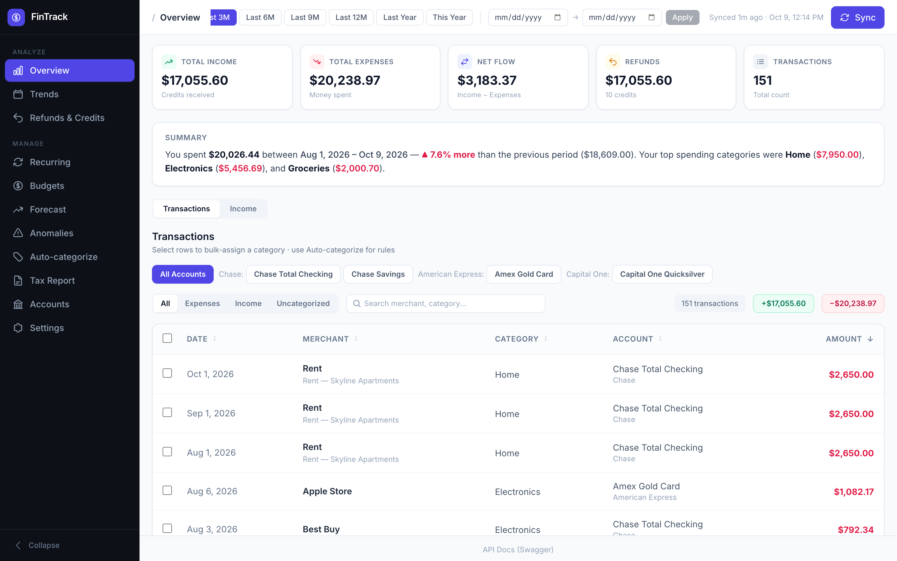

### Trends

Monthly income-vs-expense bars with category and merchant breakdowns.

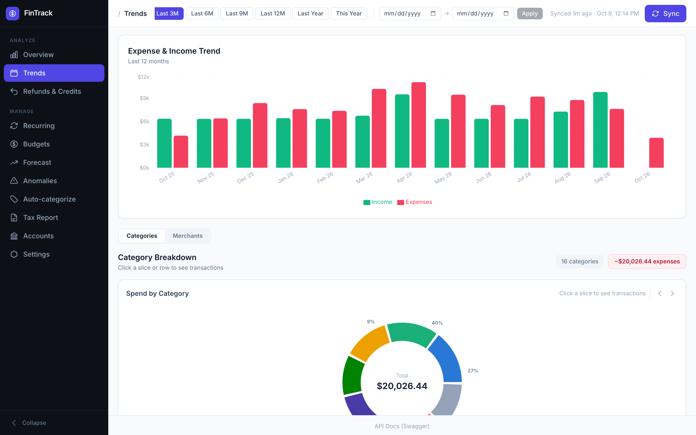

| Budgets | Forecast |
|:--:|:--:|
| Per-category envelopes with pace-adjusted overshoot projections | Projected recurring charges and upcoming-charge calendar |
| 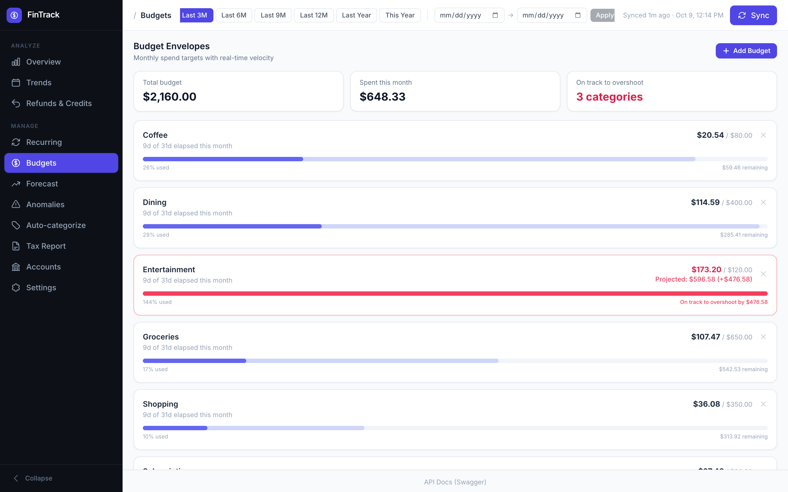 | 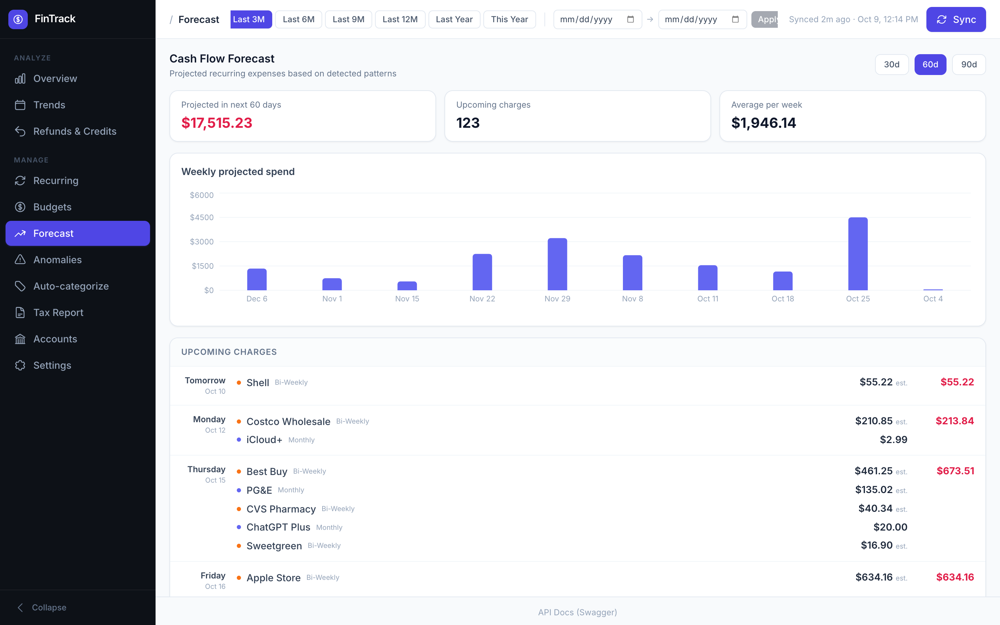 |

| Recurring | Anomalies |
|:--:|:--:|
| Auto-detected subscriptions with inferred frequency | Duplicate, unusually-large, and first-time-merchant flags |
| 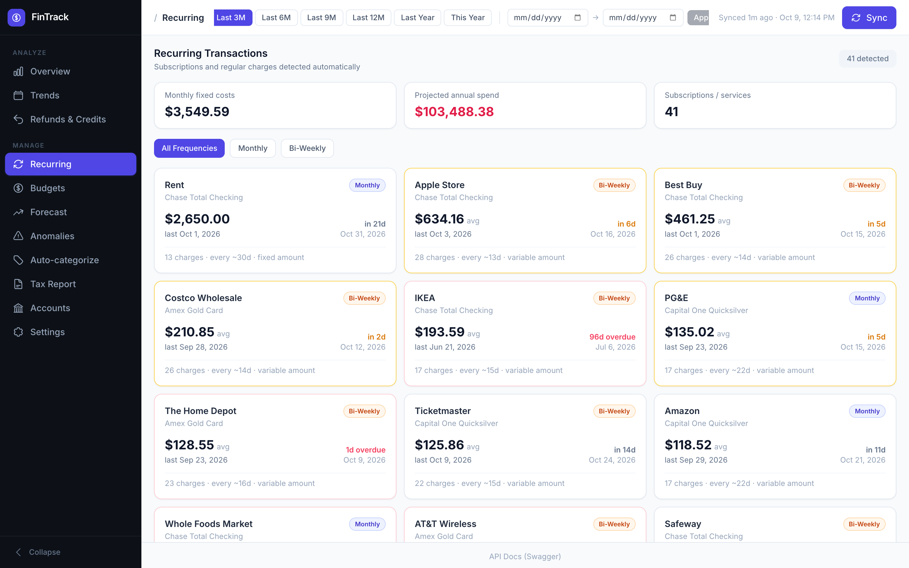 | 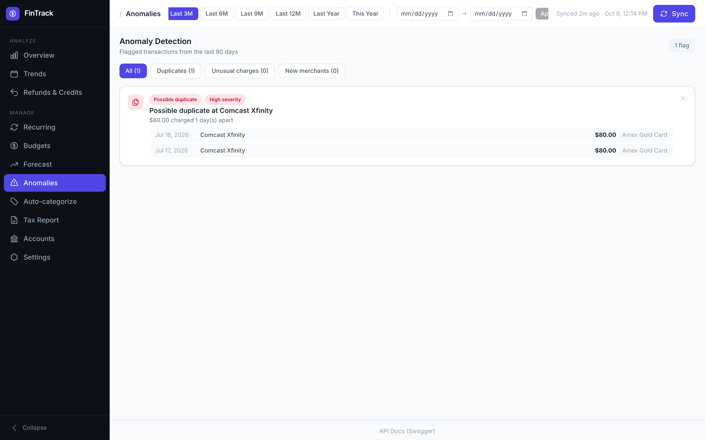 |

| Auto-categorize | Tax Report |
|:--:|:--:|
| Rules engine plus local-LLM category suggestions | Deductible spend grouped by tax-relevant category, CSV export |
| 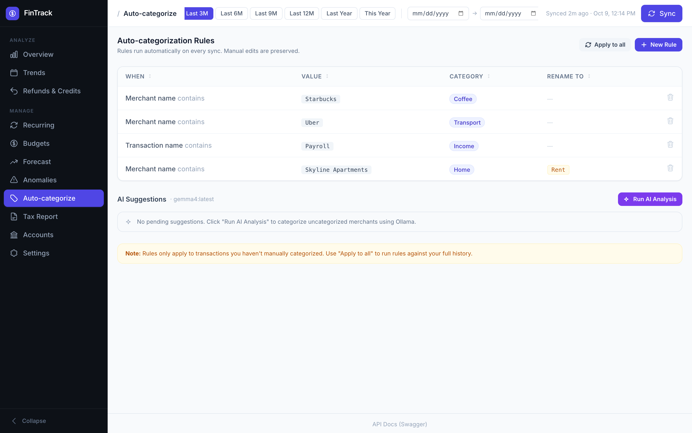 | 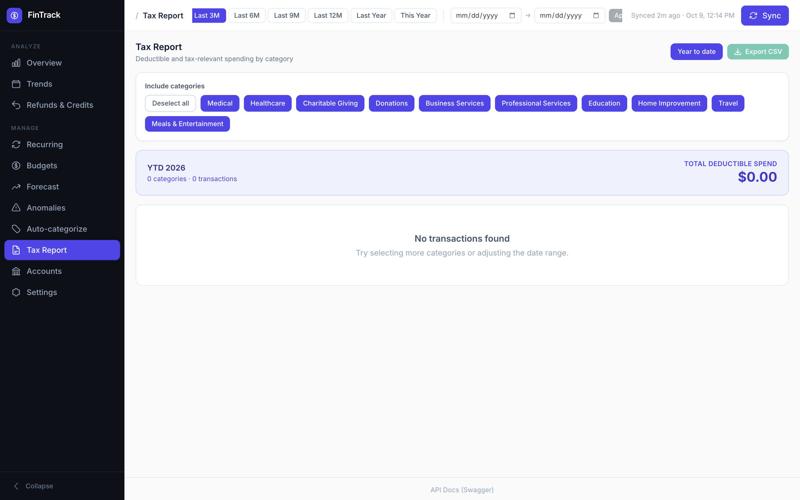 |

| Refunds & Credits | Accounts |
|:--:|:--:|
| Every inbound credit over the selected range | Connected accounts with balances, QFX import, hide/remove |
| 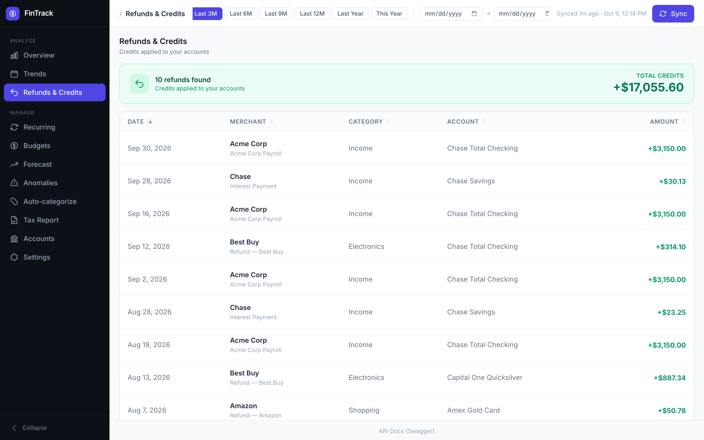 | 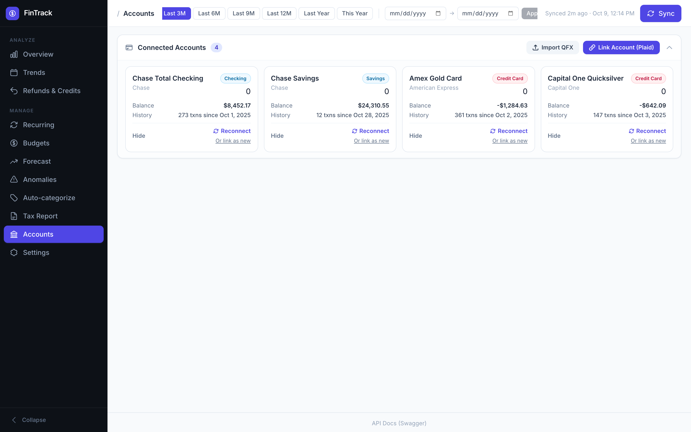 |

### Settings

Provider visibility, category management, and app preferences.

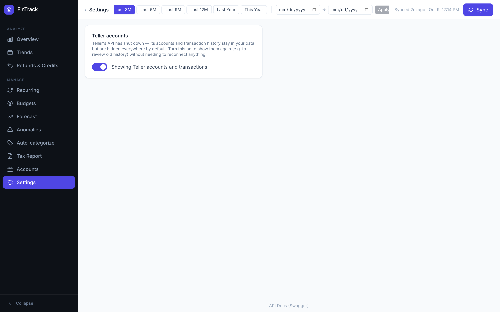

---

## Tech Stack

| Layer | Technologies |
|-------|--------------|
| **Frontend** | React 18, Vite, Tailwind CSS, Recharts, date-fns, axios |
| **Backend** | Node.js, Express, better-sqlite3, Helmet, express-rate-limit, swagger-jsdoc + swagger-ui-express |
| **Data providers** | Plaid Node SDK, Teller (REST + mutual-TLS), QFX/OFX import |
| **AI** | Ollama (local LLM) for merchant categorization & insights |
| **Database** | SQLite (WAL mode), AES-256-CBC token encryption |
| **Tooling** | Docker Compose, Makefile, nodemon |

---

## Architecture

### System Diagram

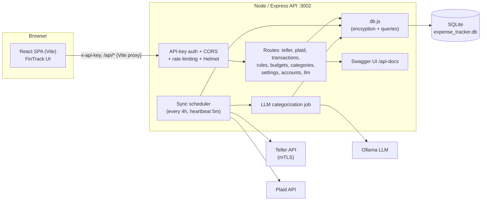

### Sync & Categorization Flow

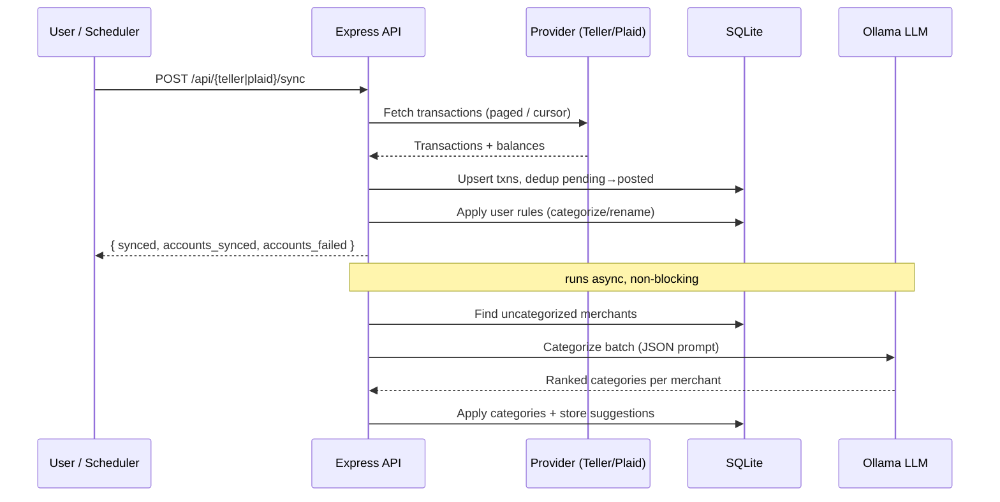

The scheduler (`backend/sync.js`) runs an initial sync 10s after startup, then checks every 5 minutes and syncs whenever **4+ hours** have elapsed since `last_synced_at`. Because it compares against a persisted timestamp (not an in-memory interval), it self-heals across process restarts and host sleep.

### Data Model

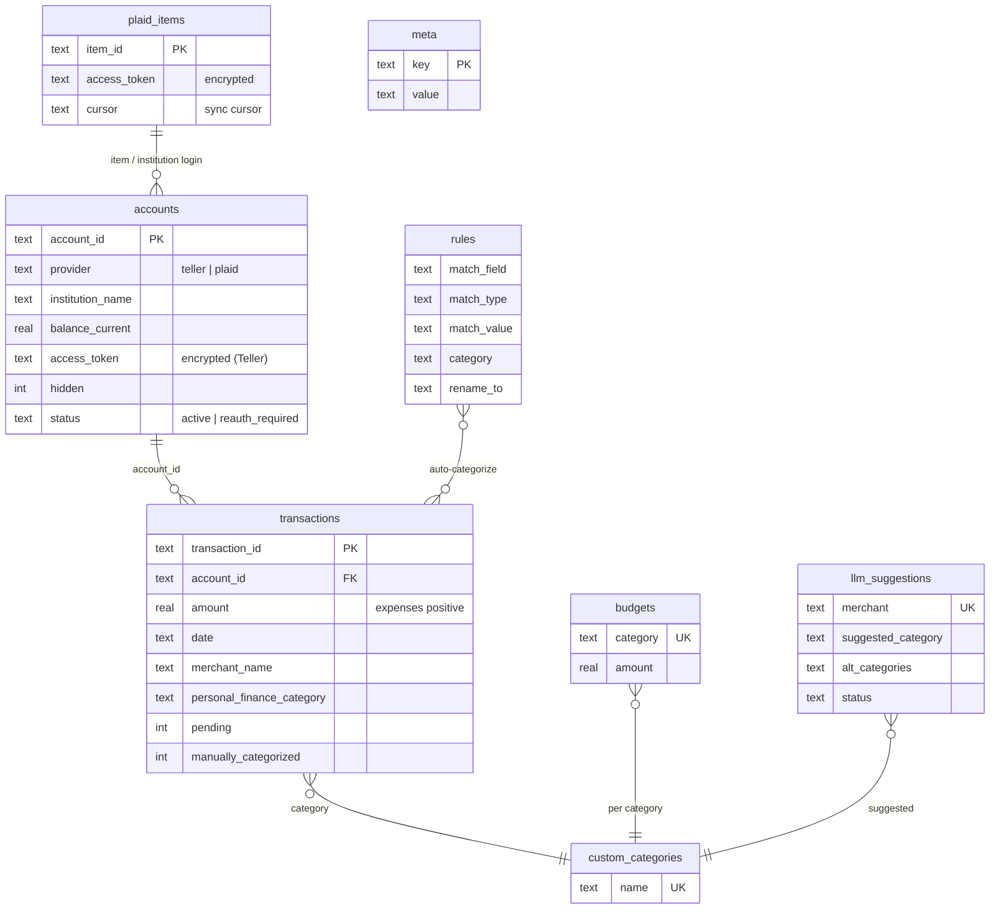

Two SQLite **views** power the read side:
- `visible_accounts` / `visible_transactions` hide retired Teller rows (Teller's API shut down; its data is kept as history) and per-account `hidden` rows, toggleable via the `show_teller_accounts` setting.

---

## Project Structure

```
expenses/
├── docker-compose.yml          # Backend + frontend services
├── Makefile                    # install / dev / docker / sync helpers
├── .env.example                # Template (partial — see env reference below)
├── backend/
│   ├── server.js               # Express entry: security, routes, scheduler
│   ├── db.js                   # SQLite schema, migrations, encryption, helpers
│   ├── sync.js                 # Teller sync + background scheduler
│   ├── plaidSync.js            # Plaid cursor-based sync
│   ├── plaidClient.js          # Plaid SDK client
│   ├── llm.js                  # Ollama batch categorization
│   ├── swagger.js              # OpenAPI spec
│   ├── middleware/
│   │   ├── auth.js             # x-api-key enforcement
│   │   └── validate.js         # Request validation
│   ├── routes/
│   │   ├── teller.js  plaid.js  transactions.js  accounts.js
│   │   ├── rules.js   budgets.js  categories.js   settings.js  llm.js
│   └── certs/                  # Teller mTLS cert + key (gitignored)
└── frontend/
    ├── vite.config.js          # Dev server + /api proxy → backend
    └── src/
        ├── main.jsx            # Attaches x-api-key to every axios request
        ├── App.jsx             # Sidebar nav, topbar, sync, routing
        ├── components/         # Overview, Trends, Budgets, Forecast, …
        ├── hooks/              # useCategories, useSort
        └── utils/              # tellerConnect, plaidLink, formatCat
```

---

## Running Locally

### Prerequisites

- **Node.js 18+** and npm
- **(Optional) Docker + Docker Compose** — for the containerized path
- **(Optional) Ollama** — for LLM auto-categorization ([ollama.com](https://ollama.com))
- At least one provider account:
  - **Plaid** — free sandbox at <https://dashboard.plaid.com/signup>
  - **Teller** — <https://teller.io> (sandbox needs only an app ID; dev/live need mTLS certs)

### 1. Get provider credentials

**Plaid:** Dashboard → **Team Settings → Keys** → copy `client_id` and the **Sandbox secret**.

**Teller:** Dashboard → create an application → copy the **Application ID**. For `development`/`production`, download the **certificate** and **private key** and drop them in `backend/certs/`.

You only need to configure the provider(s) you intend to use.

### 2. Generate secrets

```bash
# 32-byte hex key used to encrypt access tokens at rest
openssl rand -hex 32      # -> ENCRYPTION_KEY (must be exactly 64 hex chars)

# A strong random API key shared between frontend and backend
openssl rand -base64 32   # -> API_KEY / VITE_API_KEY
```

### 3. Configure environment

There are **two** env files — one for the backend, one for the frontend.

**`backend/.env`**

```bash
# ── Provider: Teller ──────────────────────────────────────────
TELLER_APP_ID=app_xxxxxxxxxxxx
TELLER_ENV=sandbox                      # sandbox | development | production
# Required only for development/production (mTLS):
TELLER_CERT_PATH=./certs/certificate.pem
TELLER_KEY_PATH=./certs/private_key.pem

# ── Provider: Plaid ───────────────────────────────────────────
PLAID_CLIENT_ID=your_client_id
PLAID_SECRET=your_sandbox_secret
PLAID_ENV=sandbox                       # sandbox | development | production

# ── Server ────────────────────────────────────────────────────
PORT=3002
NODE_ENV=development
ENCRYPTION_KEY=<64-char hex from `openssl rand -hex 32`>
API_KEY=<strong random key from `openssl rand -base64 32`>
ALLOWED_ORIGINS=http://localhost:5173,http://localhost:5174,http://localhost:5175

# ── LLM (Ollama) ──────────────────────────────────────────────
OLLAMA_URL=http://localhost:11434       # your Ollama endpoint
OLLAMA_MODEL=llama3                     # any installed model

# ── Optional ──────────────────────────────────────────────────
# DB_PATH=./expense_tracker.db          # override DB location (Docker uses /app/data/…)
# SKIP_PENDING=false                    # true = don't store pending transactions
```

**`frontend/.env`**

```bash
VITE_API_KEY=<same value as backend API_KEY>
VITE_TELLER_APP_ID=app_xxxxxxxxxxxx     # same as backend TELLER_APP_ID
VITE_TELLER_ENV=sandbox
# VITE_BACKEND_URL=http://localhost:3002  # only needed if backend isn't on :3002
```

> ⚠️ The `API_KEY` in `backend/.env` and `VITE_API_KEY` in `frontend/.env` **must match** — the frontend sends it as the `x-api-key` header on every request, and the backend rejects anything else with `401`.

### 4. (Optional) Set up Ollama

Auto-categorization and the Overview insight call a local Ollama instance. Skip this and the app still works — transactions just stay uncategorized until you add rules or categorize manually.

```bash
ollama serve                 # starts the server (default http://localhost:11434)
ollama pull llama3           # or any model; match OLLAMA_MODEL
```

### 5a. Run with the Makefile / npm

```bash
make install        # installs backend + frontend deps
make dev            # starts backend (nodemon) + frontend (Vite) together
```

Or manually, in two terminals:

```bash
# Terminal 1 — backend
cd backend && npm install && npm run dev

# Terminal 2 — frontend
cd frontend && npm install && npm run dev
```

Open **<http://localhost:5173>**. The Vite dev server proxies `/api/*` to the backend on `:3002`, and API docs are at **<http://localhost:3002/api-docs>**.

### 5b. Run with Docker Compose

Compose reads provider/API vars from `backend/.env` and a few frontend vars from your shell (or a root `.env`). Make sure `VITE_API_KEY`, `VITE_TELLER_APP_ID`, and `VITE_TELLER_ENV` are set (e.g. in a root `.env`), then:

```bash
make start          # docker compose up -d
make logs           # tail logs
make stop           # docker compose down
```

- Frontend → **<http://localhost:5174>**  (container `5173` mapped to host `5174`)
- Backend  → **<http://localhost:3002>**
- The SQLite DB is persisted in the `db_data` volume at `/app/data/expense_tracker.db`.
- Ollama is reached at `http://host.docker.internal:11434` from inside the container — adjust `OLLAMA_URL` in `docker-compose.yml` if your host/port differ.
- Teller certs are mounted read-only from `./backend/certs`.

### 6. Connect an account & sync

1. Go to the **Accounts** tab and click **Connect** (Teller Connect / Plaid Link opens).
2. In **sandbox**, use the test credentials:
   - **Plaid** — search any bank, username `user_good`, password `pass_good`.
   - **Teller** — pick any sandbox institution and continue.
3. Back in the app, click **Sync** in the top bar (or wait for the scheduler).
4. Transactions appear across the views; the LLM job auto-categorizes new merchants in the background.

---

## Environment Variables Reference

### Backend (`backend/.env`)

| Variable | Required | Default | Description |
|----------|----------|---------|-------------|
| `API_KEY` | ✅ | — | Shared secret; all `/api/*` routes require this as `x-api-key`. Server returns `503` if unset. |
| `ENCRYPTION_KEY` | ✅ | — | 64-char hex (32 bytes). Encrypts provider access tokens at rest. |
| `PORT` | | `3002` | Backend listen port. |
| `NODE_ENV` | | — | `production` disables the no-origin CORS allowance. |
| `ALLOWED_ORIGINS` | | `localhost:5173-5175` | Comma-separated CORS allowlist. |
| `TELLER_APP_ID` | Teller | — | Teller application ID. |
| `TELLER_ENV` | Teller | `sandbox` | `sandbox` / `development` / `production`. |
| `TELLER_CERT_PATH` | Teller (dev/prod) | — | Path to Teller mTLS certificate. |
| `TELLER_KEY_PATH` | Teller (dev/prod) | — | Path to Teller mTLS private key. |
| `PLAID_CLIENT_ID` | Plaid | — | Plaid client ID. |
| `PLAID_SECRET` | Plaid | — | Plaid secret (per environment). |
| `PLAID_ENV` | Plaid | `sandbox` | `sandbox` / `development` / `production`. |
| `OLLAMA_URL` | LLM | `http://host.docker.internal:5002` | Ollama endpoint for categorization. |
| `OLLAMA_MODEL` | LLM | `llama3` | Model name used for categorization. |
| `DB_PATH` | | `backend/expense_tracker.db` | SQLite file location. |
| `SKIP_PENDING` | | `false` | `true` skips storing pending transactions. |

### Frontend (`frontend/.env`)

| Variable | Required | Default | Description |
|----------|----------|---------|-------------|
| `VITE_API_KEY` | ✅ | — | Must equal backend `API_KEY`; sent as `x-api-key`. |
| `VITE_TELLER_APP_ID` | Teller | — | Teller app ID for Teller Connect. |
| `VITE_TELLER_ENV` | Teller | `sandbox` | Teller Connect environment. |
| `VITE_BACKEND_URL` | | `http://localhost:3002` | Backend URL (used by the Vite proxy / Docker). |

---

## API Reference

All routes are prefixed with `/api` and require the `x-api-key` header, **except** `/api/health` and the Swagger docs. Full interactive docs: **`/api-docs`** (spec JSON at `/api-docs.json`).

| Method | Path | Description |
|--------|------|-------------|
| GET | `/api/health` | Liveness check (public). |
| **Teller** | | |
| POST | `/api/teller/enroll` | Store a Teller enrollment (access token). |
| POST | `/api/teller/sync` | Sync Teller transactions & balances. |
| POST | `/api/teller/dedup-pending` | Collapse pending→posted duplicates. |
| GET | `/api/teller/status` | Last sync time & state. |
| GET | `/api/teller/accounts` | Connected accounts (safe fields). |
| **Plaid** | | |
| POST | `/api/plaid/link-token` | Create a Plaid Link token. |
| POST | `/api/plaid/exchange` | Exchange public token → item/access token. |
| GET | `/api/plaid/accounts` | Plaid accounts. |
| DELETE | `/api/plaid/items/:item_id` | Remove an item and its data. |
| POST | `/api/plaid/sync` | Cursor-based transaction sync. |
| **Transactions** | | |
| GET | `/api/transactions` | List (filter by date/category/account). |
| GET | `/api/transactions/summary` | Income / expenses / net / count. |
| GET | `/api/transactions/categories` | Grouped by category. |
| GET | `/api/transactions/merchants` | Grouped by merchant. |
| GET | `/api/transactions/top` | Largest expenses. |
| GET | `/api/transactions/expenses` · `/income` · `/refunds` | Expense / income / credit views. |
| GET | `/api/transactions/by-period` | Grouped by month or week. |
| GET | `/api/transactions/recurring` | Detected recurring charges. |
| GET | `/api/transactions/anomalies` | Flagged unusual transactions. |
| GET | `/api/transactions/forecast` | Projected spend. |
| GET | `/api/transactions/tax-report` · `/tax-report/export` | Tax summary + CSV export. |
| GET | `/api/transactions/overview-insight` | LLM-generated overview insight. |
| GET | `/api/transactions/uncategorized` | Uncategorized transactions. |
| POST | `/api/transactions/bulk-categorize` | Bulk assign a category. |
| PATCH | `/api/transactions/:transaction_id/category` | Set one transaction's category. |
| POST | `/api/transactions/import/qfx` | Import a QFX/OFX file. |
| **Rules / Budgets / Categories** | | |
| GET·POST·DELETE | `/api/rules` · `/api/rules/:id` | Manage auto-categorize rules. |
| POST | `/api/rules/apply` | Re-run rules over all transactions. |
| GET·POST·DELETE | `/api/budgets` · `/api/budgets/:id` | Manage budgets. |
| GET | `/api/budgets/suggestions` | Suggested budget amounts. |
| GET·POST·DELETE | `/api/categories` · `/api/categories/:id` | Manage custom categories. |
| **LLM** | | |
| GET | `/api/llm/status` | Categorization job status. |
| POST | `/api/llm/categorize` | Trigger categorization run. |
| GET | `/api/llm/suggestions` · `/suggestions/for-merchants` | View suggestions. |
| POST | `/api/llm/suggestions/accept-all` · `/accept-selected` · `/:id/accept` · `/:id/reject` | Act on suggestions. |
| DELETE | `/api/llm/suggestions/:id` | Delete a suggestion. |
| **Accounts / Settings** | | |
| PATCH | `/api/accounts/:account_id` | Rename / hide an account. |
| GET·PUT | `/api/settings` | Read / update app settings. |

---

## Security Notes

- **API-key gate** — every `/api/*` route (except `/api/health` and docs) requires a matching `x-api-key`; a missing server key returns `503` to force explicit setup.
- **Encryption at rest** — Teller/Plaid access tokens are AES-256-CBC encrypted with `ENCRYPTION_KEY` before being written to SQLite.
- **Rate limiting** — 200 req / 15 min globally; sync endpoints capped at 5 req / 5 min.
- **Helmet** security headers and a **CORS allowlist** (`ALLOWED_ORIGINS`).
- **Secrets are gitignored** — `.env`, `backend/.env`, `frontend/.env`, `*.db`, `*.pem`, and `backend/certs/` never get committed. Keep your keys out of version control.

---

## Makefile Commands

Run `make help` to list everything. Highlights:

| Command | Action |
|---------|--------|
| `make install` | Install backend + frontend dependencies. |
| `make dev` | Run backend and frontend together (dev). |
| `make dev-backend` / `make dev-frontend` | Run one side only. |
| `make build` | Production build of the frontend. |
| `make start` / `make stop` / `make restart` | Docker Compose up / down / restart. |
| `make logs` / `make logs-backend` / `make logs-frontend` | Tail container logs. |
| `make sync` | Trigger a sync via the API (`curl`). |
| `make clean` | Remove `node_modules` and build output. |
| `make clean-db` | Delete the local SQLite database (**irreversible**). |
